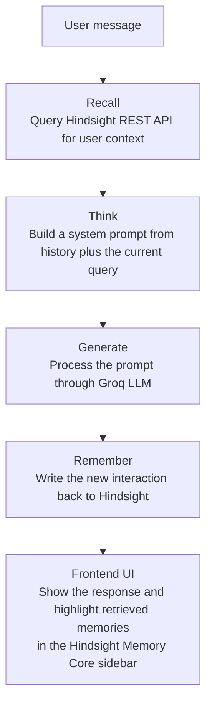
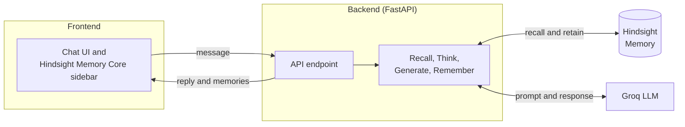

# Context-Aware Customer Support Agent (Hindsight MVP)

An intelligent, context-aware customer support agent built for the hackathon. Unlike traditional stateless chatbots that forget past interactions upon page refresh, this application leverages **Vectorize's Hindsight memory system** and **Groq** to persistently recall user history, adapt its troubleshooting guidance over time, and eliminate redundant questioning.

**Project title:** Context-Aware SaaS Support Agent

**Short summary:** An AI-powered customer support agent built with Vectorize Hindsight and Groq that persistently remembers user technical environments, past ticket history, and previous troubleshooting steps to eliminate redundant questioning and deliver instant, personalized resolutions.

---

## Table of Contents

- [The Problem](#the-problem)
- [The Solution and Hindsight Integration](#the-solution-and-hindsight-integration)
- [Architecture and the Recall-Think-Generate-Remember Workflow](#architecture-and-the-recall-think-generate-remember-workflow)
- [How We Used Hindsight](#how-we-used-hindsight)
- [Demo Scenario](#demo-scenario)
- [Tech Stack](#tech-stack)
- [Local Installation and Running Instructions](#local-installation-and-running-instructions)
- [Project Structure](#project-structure)
- [Highlights and Real-World Impact](#highlights-and-real-world-impact)
- [Submission Deliverables Checklist](#submission-deliverables-checklist)

---

## The Problem

Traditional customer support chatbots are entirely stateless. They forget everything the moment a user refreshes the page or opens a new session. Enterprise users (like Lead Engineers) are forced to repeatedly explain their tech stacks (for example, Node.js on AWS), share the same error logs, and restate previously attempted firewall fixes across multiple tickets, creating immense friction and delayed resolutions.

---

## The Solution and Hindsight Integration

Our project solves this by integrating Vectorize's Hindsight memory system into an intelligent support workflow. Instead of relying on manual data retrieval or reactive searching, our application executes an automated Recall-Think-Generate-Remember loop on every interaction:

- **Recall:** Instantly queries the Hindsight API using the user's unique ID to retrieve deep historical context, past observations, and environmental preferences.
- **Think and Generate:** Dynamically bundles these memories with a Groq-powered LLM (`qwen/qwen3.8-27b`) to generate an advanced, hyper-personalized troubleshooting response.
- **Remember:** Continuously writes new interaction insights back to the Hindsight database, allowing the agent to learn and evolve dynamically over time.

---

## Architecture and the Recall-Think-Generate-Remember Workflow

Our FastAPI backend implements an explicit cognitive loop on every incoming customer message to ensure seamless personalization:

```
[User Message]
      │
      ▼
 RECALL ────> Queries Hindsight REST API for user-specific context (e.g., tech stack, past tickets)
      │
      ▼
 THINK ─────> Dynamically constructs system prompts combining historical context with current queries
      │
      ▼
 GENERATE ──> Processes the prompt through Groq's high-speed LLM (qwen/qwen3.8-27b)
      │
      ▼
 REMEMBER ──> Writes the new interaction back to Hindsight to continuously update user memory
      │
      ▼
[Frontend UI] ──> Displays response and highlights retrieved memories in the live "Hindsight Memory Core" sidebar
```

The same flow as a diagram:



1. **Recall:** When a user (for example, `sarah_eng_01`) sends a message, the backend pings the Hindsight API to retrieve relevant historical observations and experiences.
2. **Think:** The backend bundles the retrieved memories (such as past AWS configurations, firewall rules, and previous timeout logs) into a structured system prompt.
3. **Generate:** The context-enriched prompt is sent to the Groq API, producing a highly targeted, accurate tech-support response without asking redundant questions.
4. **Remember:** The latest interaction is automatically saved back to Hindsight, allowing the agent to learn and evolve across sessions.

### System architecture



---

## How We Used Hindsight

Hindsight is the memory layer of this project. The backend uses it in two places on every message: before the LLM call, to **recall** what we already know about the customer, and after the LLM call, to **remember** what just happened.

- **Per-customer memory:** Each customer is identified by a unique ID (for example, `sarah_eng_01`). Recall and remember calls are tied to that ID, so one customer's history never leaks into another's.
- **What gets stored:** Technical environment details (such as Node.js on AWS), past tickets, the fixes that were tried, and new insights from each conversation.
- **What gets recalled:** The memories most relevant to the customer's new message, which the backend places into the system prompt before calling Groq.
- **Visible to the user:** The retrieved memories are also returned to the frontend and shown in the "Hindsight Memory Core" sidebar, so it is clear what the agent remembered.
- **Seeded history:** `backend/seed_hindsight.py` loads Sarah's three mock tickets into Hindsight, so the demo shows memory working from the first message.

### Raw REST API instead of the Python SDK

We integrated Hindsight through its **raw REST API** (called with Python's `requests` library) instead of the official Python SDK. Our environment runs Python 3.9, and the SDK's version requirements did not allow us to use it there. Rather than upgrading the runtime or dropping Hindsight, we called the HTTP endpoints directly from the FastAPI backend.

This kept the integration working on our existing setup, with no dependency on a specific SDK version. It also means every Hindsight call in `main.py` is a plain HTTP request that is easy to read, test, and debug.

---

## Demo Scenario

The demo uses a seeded customer, **Sarah** (`sarah_eng_01`), a Lead Engineer who uses a Node.js backend hosted on AWS.

| Ticket | Date | Summary | Status |
|---|---|---|---|
| TKT-1001 | 2026-10-08 | 401 Unauthorized errors because API keys were revoked during a security rotation. New API keys generated, AWS environment variables updated, Node.js service restarted. | Resolved |
| TKT-1042 | 2026-10-22 | Intermittent connection timeouts caused by restrictive AWS security group and firewall rules. Required platform IP ranges added to the allowlist and conflicting deny rules removed. | Resolved |
| TKT-1087 | 2026-11-05 | API keys reset and firewall rules cleared. Authentication and outbound API calls work, but the webhook endpoint is still timing out. | Open |

For TKT-1087, the recommended next checks are webhook handler response time, inbound security group rules, load balancer timeout settings, and Node.js server logs.

---

## Tech Stack

- **Backend:** Python, FastAPI, Uvicorn, Requests
- **AI Model:** Groq API (`qwen/qwen3.8-27b`) for ultra-fast, high-speed inference
- **Memory Core:** Vectorize Hindsight REST API (Cloud)
- **Frontend:** Custom-styled HTML5, CSS3, and JavaScript (v2). A modern, responsive SaaS chat interface featuring a real-time animated "Hindsight Memory Core" sidebar that gives complete visual transparency into real-time context retrieval.

---

## Local Installation and Running Instructions

### 1. Clone the Repository

```bash
git clone https://github.com/dineshav05/hindsight-support-agent.git
cd hindsight-support-agent
```

### 2. Install Backend Dependencies

Navigate to the backend folder and install the required packages:

```bash
cd backend
pip install fastapi uvicorn pydantic requests groq
```

### 3. Run the FastAPI Backend Server

Start the backend using Python's module runner:

```bash
python3 -m uvicorn main:app --reload --host 127.0.0.1 --port 8000
```

### 4. Launch the Frontend UI

Open a separate terminal window, navigate to the frontend directory, and spin up a local web server:

```bash
cd frontend
python3 -m http.server 3000
```

Open your browser and navigate to [http://127.0.0.1:3000](http://127.0.0.1:3000) to interact with the live context-aware support agent.

---

## Project Structure

```
hindsight-support-agent/
├── backend/
│   ├── main.py              # FastAPI server implementing the memory loop
│   └── seed_hindsight.py    # Script used to inject mock user history
├── frontend/
│   └── index.html           # Polished SaaS chat interface & memory sidebar
└── README.md                # Project documentation
```

---

## Highlights and Real-World Impact

- **Eliminates Redundancy:** Enterprise clients no longer need to repeat their environment specs (for example, Node.js on AWS) across support sessions.
- **Visualized Memory Core:** The UI features a dedicated, animated sidebar displaying live memory retrieval metrics, giving judges complete transparency into the agent's cognitive state.
- **Real-World Business Impact:** By bridging the gap between stateless AI and persistent user memory, this agent reduces Average Handle Time (AHT), removes customer fatigue from repeating details, and provides a blueprint for next-generation B2B customer support SaaS.

---


# Frontend + Backend Integration (V2)

## What changed
- Replaced the static demo frontend with a live API-connected interface.
- Added account dropdown, account management, new session, theme toggle, chat, memory list and memory invalidation.
- Expanded FastAPI with `/users`, `/sessions`, `/memories`, `/chat`, and `/health`.
- Kept the existing Hindsight bank URL pattern and Groq model configurable.
- Kept the `/chat` request compatible with the BAND adapter (`user_id`, `message`); `session_id` is optional.

## Setup
1. Copy `.env.example` to `.env` in the project root and add your real API keys.
2. Install dependencies: `pip install -r backend/requirements.txt`.
3. Confirm the Hindsight banks exist for `sarah_eng_01`, `user_2`, and `user_3`. The first ID preserves the existing demo customer bank. Create the other banks in Hindsight before using those accounts; this app does not assume a bank-creation endpoint.
4. Run from the project root:
   `uvicorn backend.main:app --reload --host 127.0.0.1 --port 8000`
5. Serve the frontend folder (recommended):
   `python -m http.server 5500 --directory frontend`
6. Open `http://127.0.0.1:5500`.

## API endpoints
- `GET /users`
- `POST /users` with `{ "name": "User 4", "handle": "user_4" }`
- `PATCH /users/{user_id}` with optional `name` and/or `handle`
- `DELETE /users/{user_id}` (deactivates account; does not delete Hindsight bank)
- `POST /sessions?user_id=sarah_eng_01`
- `POST /chat` with `{ "user_id": "sarah_eng_01", "message": "...", "session_id": "..." }`
- `GET /memories?user_id=sarah_eng_01`
- `DELETE /memories/{memory_id}?user_id=sarah_eng_01`
- `GET /health`

## Important behavior / limitations
- The user registry is a local `users.json` file intended for a single-process development setup. Use a database for concurrent/multi-instance production deployments.
- The `id` is the stable Hindsight bank identifier. Editing a display name or handle does not migrate the memory bank. If you need to change a bank ID, plan and perform a separate memory migration.
- Creating an account only registers it locally. Create a Hindsight bank with the same stable `id` before sending messages from that account.
- Deleting an account deactivates it and preserves its Hindsight bank. It does not erase customer memories.
- A new session creates a frontend session ID and clears the visible transcript. It intentionally does not erase long-term Hindsight memories. Session IDs are not yet used to partition or persist chat transcripts on the backend.
- The frontend expects the Hindsight memory list endpoint to return `items`, and each memory should expose `id` (or `memory_id`) and text/content fields for display/deletion. Verify this against your Hindsight API response.
- This is not production-secure multi-tenancy: there is no login/authentication layer. Do not expose this API publicly until authentication, authorization, HTTPS, and persistent database storage are implemented.
- BAND adapter remains compatible with `/chat`. It should continue sending the actual stable Hindsight bank ID as `user_id`. Its current integration does not create browser sessions.
