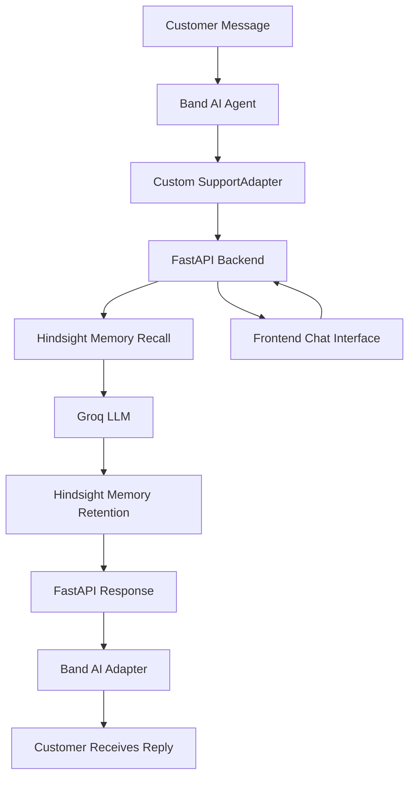
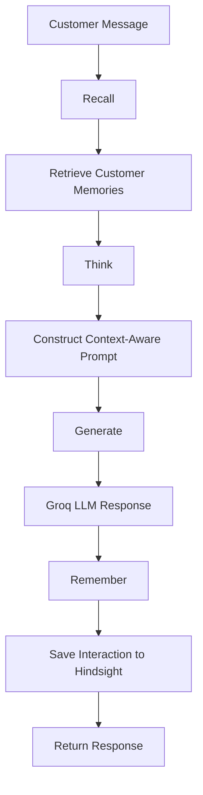
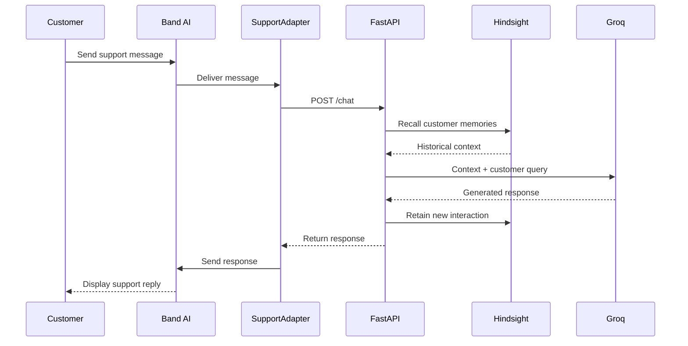

# Context-Aware SaaS Support Agent
### An Intelligent Customer Support System Powered by Band AI, Hindsight Memory and Groq

An intelligent, context-aware customer support agent that remembers previous customer interactions, understands technical environments, and delivers personalized troubleshooting responses across sessions.

Unlike traditional stateless chatbots that forget previous interactions, this application combines **Band AI, Vectorize Hindsight, and Groq** to create a persistent, memory-powered customer support experience.

**Project Title:** Context-Aware SaaS Support Agent

**Short Summary:** An AI-powered customer support agent that integrates Band AI for messaging and agent connectivity, Vectorize Hindsight for persistent customer memory, and Groq for intelligent response generation. It remembers user technical environments, past tickets, and previous troubleshooting steps to eliminate redundant questioning and provide personalized support.

---

## Table of Contents

1. The Problem
2. The Solution
3. Technology Integrations
4. System Architecture
5. Recall-Think-Generate-Remember Workflow
6. Band AI Integration
7. Hindsight Memory Integration
8. Groq AI Integration
9. Demo Scenario
10. Tech Stack
11. Project Structure
12. Installation and Setup
13. Running the Application
14. API Endpoints
15. Highlights and Real-World Impact
16. Future Scope

---

## 1. The Problem

Traditional customer support chatbots are largely stateless. They forget previous conversations when a customer refreshes the page or starts a new session.

Enterprise users, such as Lead Engineers, are often forced to repeatedly:

- Explain their technical environments.
- Share the same error logs.
- Describe previously attempted troubleshooting steps.
- Provide account and configuration details again.
- Reopen previously discussed issues without historical context.

For example, a customer using a Node.js backend hosted on AWS may have already completed several firewall and API authentication fixes. A traditional chatbot may ask the customer to repeat those steps in every new session.

This creates unnecessary friction, increases resolution time, and reduces customer satisfaction.

## 2. The Solution

Our project introduces a context-aware customer support system that combines three technologies:

- **Band AI:** Handles incoming customer messages and delivers support responses through a Band agent.
- **Vectorize Hindsight:** Provides persistent, customer-specific memory across conversations.
- **Groq:** Generates intelligent and personalized troubleshooting responses using a large language model.

The application uses a custom Python adapter to connect Band AI with our FastAPI backend.

Whenever a customer sends a message, the backend retrieves relevant historical memories, generates a context-aware response, and saves the latest interaction for future use.

This creates a continuous support experience where customers do not need to repeatedly explain information already available in their history.

---

## 3. Technology Integrations

### Band AI – Messaging and Agent Connectivity

Band AI provides the messaging and agent interface.

We use its Python SDK and a custom `SimpleAdapter` to:

- Receive customer messages.
- Filter invalid and non-user messages.
- Identify the sender.
- Forward customer queries to our FastAPI backend.
- Deliver generated AI responses back through Band.

### Vectorize Hindsight – Persistent Memory

Hindsight acts as the memory layer of the application.

It stores and recalls:

- Customer technical environments.
- Previous support tickets.
- Previously attempted troubleshooting steps.
- Customer preferences and relevant historical observations.

This allows the AI agent to understand a customer's history instead of starting every conversation from scratch.

### Groq – AI Response Generation

Groq powers the language-model inference.

The backend combines the current customer query with relevant historical memories and sends the context-enriched prompt to Groq.

The model generates personalized technical support responses based on the available customer history.

---

## 4. System Architecture

The application consists of a messaging layer, an application backend, an AI inference service, and a persistent memory service.



### Architecture Components

| Component | Responsibility |
|---|---|
| Band AI | Messaging and agent connectivity |
| SupportAdapter | Receives and forwards messages |
| FastAPI | Handles backend processing |
| Hindsight | Persistent customer memory |
| Groq | AI response generation |
| Frontend | Customer chat interface |

---

## 5. Recall-Think-Generate-Remember Workflow

Our FastAPI backend implements a four-stage workflow for every customer interaction.

### 1. Recall

The backend queries the Hindsight REST API using the customer's unique ID.

It retrieves relevant historical observations, technical environment details, and previous troubleshooting information.

### 2. Think

The retrieved memories are combined with the current customer query to construct a structured system prompt.

This gives the AI model access to relevant historical context.

### 3. Generate

The context-enriched prompt is sent to the Groq API.

The language model generates a personalized technical support response without unnecessarily repeating previously completed troubleshooting steps.

### 4. Remember

After generating the response, the backend stores the latest customer interaction in Hindsight.

This allows the support agent to use the new information in future conversations.



---

## 6. Band AI Integration – Messaging and Agent Connectivity

Band AI is integrated into our application through its Python SDK.

We created a custom `SupportAdapter` by extending Band's `SimpleAdapter` class.

This adapter acts as a communication bridge between Band AI and our existing FastAPI support backend.

### How Band AI Works in Our Project

**1. Message Reception**

The Band agent continuously listens for incoming customer messages.

**2. Message Filtering**

The custom adapter checks the sender type and ignores messages that are not from users. It also ignores empty messages.

**3. Customer Identification**

The adapter extracts the sender ID from the incoming Band message.

This ID is passed to the FastAPI backend as the customer identifier.

**4. Backend Communication**

The adapter forwards the customer's message to the backend using an asynchronous HTTP request.

Endpoint:

`POST /chat`

**5. AI Response Processing**

The FastAPI backend retrieves customer memories from Hindsight and generates a personalized response through Groq.

**6. Response Delivery**

The generated response is returned to the Band adapter and delivered to the customer through Band AI.

### Band AI Integration Workflow



### Custom Band AI Adapter

The integration uses:

```python
from band import Agent
from band.core import SimpleAdapter
```

The custom adapter implements the following functionality:

- Receives incoming messages through `on_message()`.
- Validates the message sender.
- Extracts the Band sender ID.
- Forwards the message to the FastAPI backend.
- Processes the backend response.
- Sends the final response through Band AI.

### Band Agent Initialization

```python
agent = Agent.create(
    adapter=SupportAdapter(),
    agent_id=BAND_AGENT_ID,
    api_key=BAND_API_KEY
)

await agent.start()
await agent.run_forever()
```

The agent runs continuously and waits for incoming customer messages.

### Why Band AI?

Band AI allows our existing support backend to communicate through an agent-based messaging interface.

It separates message handling from the core AI and memory logic, making the overall architecture easier to extend and maintain.

**Note:** Our current implementation uses one Band agent connected to the FastAPI backend. It does not currently implement multiple collaborating specialist agents.

---

## 7. Hindsight Memory Integration

Hindsight is the persistent memory layer of our application.

It is integrated directly into the FastAPI backend through its REST API using Python's `requests` library.

### Per-Customer Memory

Each customer is associated with a unique memory bank ID.

For example:

`sarah_eng_01`

This allows the backend to retrieve and store customer-specific information.

### What Gets Stored?

The application stores:

- Customer technical environment.
- Previous support tickets.
- Troubleshooting steps already completed.
- Important technical observations.
- Relevant information from new conversations.

### Memory Recall

Before generating a response, the backend sends a recall request to Hindsight.

```python
recall_url = (
    f"{HINDSIGHT_BASE_URL}/{user_id}/memories/recall"
)

response = requests.post(
    recall_url,
    headers=HINDSIGHT_HEADERS,
    json={
        "query": (
            f"Customer information, previous conversations, "
            f"and relevant details: {message}"
        )
    },
    timeout=30
)
```

The retrieved memories are added to the system prompt.

### Memory Retention

After the AI generates a response, the interaction is saved.

```python
retain_url = (
    f"{HINDSIGHT_BASE_URL}/{user_id}/memories"
)

retain_payload = {
    "items": [
        {
            "content": (
                f"Customer message: {user_message}\n"
                f"Support agent response: {agent_reply}"
            ),
            "context": "Customer support conversation"
        }
    ]
}

response = requests.post(
    retain_url,
    headers=HINDSIGHT_HEADERS,
    json=retain_payload,
    timeout=30
)
```

### Seeded Customer History

The project includes `seed_hindsight.py`, which loads sample historical customer information into Hindsight.

This ensures that the demo can demonstrate memory recall from the first interaction.

---

## 8. Groq AI Integration

Groq provides the AI inference capability.

The backend uses the Groq Python SDK.

```python
from groq import Groq

groq_client = Groq(
    api_key=GROQ_API_KEY
)
```

### Context-Aware Response Generation

The backend constructs a system prompt containing:

- Retrieved customer memories.
- Current customer query.
- Previous troubleshooting information.
- Instructions to avoid redundant questions.
- Instructions not to invent customer information.

The prompt is sent to the configured Groq model.

```python
chat_completion = groq_client.chat.completions.create(
    messages=[
        {
            "role": "system",
            "content": system_prompt
        },
        {
            "role": "user",
            "content": user_message
        }
    ],
    model="qwen/qwen3.8-27b",
    temperature=0.4
)

reply = chat_completion.choices[0].message.content
```

The generated response is returned to the Band adapter through FastAPI.

The configured model must be available to the Groq API account.

---

## 9. Demo Scenario

Our demonstration uses a seeded customer named **Sarah**.

Customer ID:

`sarah_eng_01`

Role:

Lead Engineer

Technical Environment:

- Backend: Node.js
- Infrastructure: AWS
- Issue Category: API and Webhook Connectivity

### Historical Support Tickets

| Ticket | Date | Summary | Status |
|---|---|---|---|
| TKT-1001 | 2026-10-08 | API authentication errors caused by revoked API keys during a security rotation. New keys generated and environment variables updated. | Resolved |
| TKT-1042 | 2026-10-22 | Intermittent connection timeouts caused by restrictive AWS security group and firewall rules. | Resolved |
| TKT-1087 | 2026-11-05 | API keys reset and firewall rules cleared. Authentication works, but the webhook endpoint continues timing out. | Open |

### Live Demo Example

**Customer:**

"My webhook endpoint is still timing out. What should I check?"

**What the agent remembers:**

- Customer uses a Node.js backend hosted on AWS.
- API keys were previously reset.
- Firewall rules were already cleared.
- Earlier authentication problems were resolved.
- The webhook timeout remains unresolved.

**Expected AI Response:**

"Since we've already reset your API keys and cleared the previous firewall rules, let's avoid repeating those steps. Given your Node.js backend on AWS, I'd recommend checking your webhook handler response time, inbound security group rules, load balancer timeout settings, and Node.js server logs next."

### What This Demonstrates

1. The customer sends a message through Band AI.
2. Band forwards the message to the FastAPI backend.
3. Hindsight recalls Sarah's previous tickets.
4. Groq generates a personalized troubleshooting response.
5. The latest interaction is stored in Hindsight.
6. Band AI delivers the response.

This demonstrates how persistent memory improves the customer support experience across conversations.

---

## 10. Tech Stack

| Technology | Purpose |
|---|---|
| Python | Main programming language |
| FastAPI | Backend API framework |
| Band AI | Messaging and agent connectivity |
| Vectorize Hindsight | Persistent memory system |
| Groq API | AI inference and response generation |
| Qwen | Language model |
| Requests | REST API communication |
| Python-dotenv | Environment variable management |
| HTML5 | Frontend structure |
| CSS3 | Frontend styling |
| JavaScript | Frontend interaction |
| Uvicorn | ASGI server |

---

## 11. Project Structure

```text
hindsight-support-agent/
│
├── backend/
│   ├── main.py
│   ├── band_agent.py
│   └── seed_hindsight.py
│
├── frontend/
│   └── index.html
│
├── .env
├── .gitignore
└── README.md
```

### File Responsibilities

**backend/main.py**

Implements the FastAPI backend, Hindsight memory recall and retention, and Groq response generation.

**backend/band_agent.py**

Initializes the Band AI agent and implements the custom SupportAdapter for receiving and forwarding customer messages.

**backend/seed_hindsight.py**

Inserts sample customer history into Hindsight for demonstration purposes.

**frontend/index.html**

Contains the custom customer support chat interface and Hindsight Memory Core sidebar.

**.env**

Stores API credentials and configuration variables.

---

## 12. Installation and Setup

### Prerequisites

- Python version supported by your installed Band SDK.
- Git.
- Band AI account and API credentials.
- Vectorize Hindsight API key.
- Groq API key.

### Step 1: Clone the Repository

```bash
git clone https://github.com/dineshav05/hindsight-support-agent.git

cd hindsight-support-agent
```

### Step 2: Create a Virtual Environment

```bash
python3 -m venv venv
```

Activate it on macOS or Linux:

```bash
source venv/bin/activate
```

### Step 3: Install Dependencies

```bash
pip install fastapi uvicorn pydantic requests groq python-dotenv band
```

Use the official Band SDK installation instructions if its package installation name differs for your SDK version.

### Step 4: Configure Environment Variables

Create a `.env` file in the project root.

```env
# Hindsight
HINDSIGHT_API_KEY=your_hindsight_api_key

# Groq
GROQ_API_KEY=your_groq_api_key

# Band AI
BAND_AGENT_ID=your_band_agent_id
BAND_API_KEY=your_band_api_key

# Backend URL
SUPPORT_API_URL=http://127.0.0.1:8000/chat
```

Never upload your `.env` file to GitHub.

### Step 5: Configure Customer Identity

The Band adapter currently forwards `msg.sender_id` as the Hindsight customer ID.

For the seeded Sarah demo, ensure the Band sender ID resolves to the same memory bank ID:

`sarah_eng_01`

If Band generates a different sender ID, implement a customer-ID mapping before forwarding the request.

### Step 6: Seed Customer History

Run:

```bash
cd backend

python3 seed_hindsight.py
```

This inserts the sample customer history into Hindsight.

---

## 13. Running the Application

The application requires separate running processes for the backend, Band agent, and frontend.

### Terminal 1: Start FastAPI Backend

Navigate to the backend directory:

```bash
cd backend
```

Run:

```bash
python3 -m uvicorn main:app --reload --host 127.0.0.1 --port 8000
```

The backend will be available at:

`http://127.0.0.1:8000`

API documentation:

`http://127.0.0.1:8000/docs`

### Terminal 2: Start Band AI Agent

Open another terminal and navigate to the backend directory.

Run:

```bash
python3 band_agent.py
```

The agent initializes and waits for incoming customer messages.

### Terminal 3: Start Frontend

Open another terminal.

Navigate to the frontend directory:

```bash
cd frontend
```

Start the local server:

```bash
python3 -m http.server 3000
```

Open the application:

`http://127.0.0.1:3000`

---

## 14. API Endpoints

### Health Check

**GET /**

Checks whether the FastAPI backend is running.

Example response:

```json
{
  "status": "running",
  "message": "Hindsight Support Agent Backend is active"
}
```

### Customer Chat

**POST /chat**

Processes customer messages and generates context-aware responses.

Example request:

```json
{
  "user_id": "sarah_eng_01",
  "message": "My webhook endpoint is still timing out."
}
```

Example response:

```json
{
  "reply": "Since we've already completed the previous firewall and API key troubleshooting, let's investigate your webhook handler response time and load balancer timeout settings next.",
  "memory_used": [
    "Customer uses a Node.js backend hosted on AWS.",
    "Previous firewall troubleshooting was completed."
  ]
}
```

The actual response content and recalled memories depend on the stored customer history and the model output.

---

## 15. Highlights and Real-World Impact

### Persistent Customer Memory

Hindsight allows the support agent to remember previous conversations and customer-specific technical information.

### Band AI Connectivity

Band AI connects customer messaging with our existing AI-powered backend through a custom Python adapter.

### Context-Aware Responses

Groq generates responses using relevant customer memories rather than treating every query as an isolated conversation.

### Eliminates Redundant Troubleshooting

The agent can recognize previously completed steps and focus on unresolved problems.

### Transparent Memory Retrieval

The frontend includes a dedicated Hindsight Memory Core sidebar that displays retrieved customer memories.

### Modular Architecture

Band AI, Hindsight, and Groq have separate responsibilities, making the system easier to maintain and extend.

### Real-World Business Impact

The application demonstrates how persistent memory can improve customer support by:

- Reducing repetitive questioning.
- Improving troubleshooting continuity.
- Reducing customer effort.
- Supporting faster issue resolution.
- Improving the overall customer experience.

---

## 16. Future Scope

The project can be extended with:

- Multiple specialized support agents for billing, technical troubleshooting, and escalation.
- Automated ticket classification and prioritization.
- Integration with external SaaS ticketing platforms.
- Real-time monitoring of unresolved customer issues.
- Improved customer identity management.
- Advanced analytics for support resolution times.
- Human-agent handoff for complex technical problems.

These are potential future enhancements and are not claimed as currently implemented features.

---

## Conclusion

The Context-Aware SaaS Support Agent demonstrates how persistent memory and AI-powered messaging can transform traditional customer support.

By integrating **Band AI for messaging, Vectorize Hindsight for persistent memory, and Groq for intelligent response generation**, we have built a modular support architecture that remembers customer history and delivers personalized troubleshooting guidance.

Instead of treating every conversation as a new interaction, the system builds upon previous knowledge to provide a more continuous and efficient customer support experience.

**Band AI + Hindsight Memory + Groq Intelligence = Context-Aware Customer Support.**
